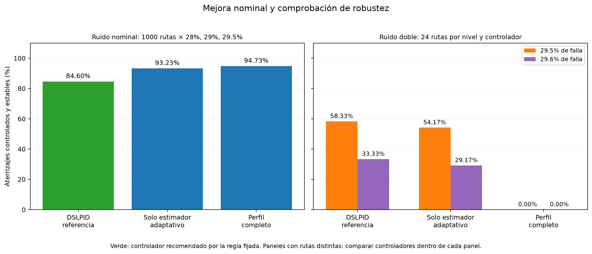

# Resultados finales de la ronda 5

Campaña cerrada el 12 de noviembre de 2026. La evaluación principal terminó sus
129 bloques; los 75 modelos, la confirmación independiente y la auditoría final
están completos. El cierre corresponde a las 22:11:22 UTC (17:11:22 en Lima).

La recomendación registrada es **baseline_original**, el DSLPID modificado usado
como referencia de la ronda 4: estimador original, descenso sin supervisor de
preparación, política de emergencia legacy y reserva de empuje 0.005.
La [configuración exacta](recommended_controller.json) no requiere una red.

## Resultado y motivo de la decisión

Confirmación con 1000 rutas nuevas por nivel, efectividad estimada y ruido habitual:

| Configuración | 28% | 29% | 29.5% | Media de esos tres niveles |
|---|---:|---:|---:|---:|
| Referencia DSLPID | 98.40% | 88.80% | 66.60% | 84.60% |
| Solo estimador adaptativo | 100.00% | 96.60% | 83.10% | 93.23% |
| Perfil completo | 100.00% | 97.00% | 87.20% | 94.73% |

Las mejoras con ruido habitual son estadísticamente respaldadas. La regla de
incorporación también exigía no perder éxito neto en sensibilidad y se mantuvo
sin cambios después de observar las pruebas. Al duplicar el ruido, el estimador
solo perdió dos éxitos frente a la referencia en 96 casos. El perfil completo
agotó el plazo en los 48 casos de 29.5% y 29.6%, manteniendo el descenso pausado.
Ninguna actualización superó esa condición de incorporación.

La muestra de sensibilidad es pequeña y no demuestra inferioridad universal.
La decisión es conservadora y se refiere a esta configuración y distribución.

Los paneles usan conjuntos distintos de rutas. Comparar configuraciones dentro
de cada panel; no interpretar la diferencia entre paneles como un antes/después
sobre los mismos vuelos.

Las seis arquitecturas se evaluaron con cinco semillas y 60 rutas compartidas.
Ninguna familia demostró una mejora simultáneamente significativa frente al
DSLPID completo; las 15 estrategias seleccionadas por validación quedaron en
abstención. Esa abstención ejecuta solo PID y no se atribuye como éxito neuronal.
Las variantes CSIL, ME-IRL y RIME son adaptaciones locales. Al 30%, 35% y 50%
todos los controladores de esta campaña tuvieron 0% de éxito.

## Archivos

- [Informe completo](INFORME_FINAL_RONDA5.txt): todas las arquitecturas, imitación,
  afinado, recompensas, sensibilidad, límites y tiempos.
- [Curvas y métricas por modelo](success_rates.csv).
- [Resumen de confirmación](confirmation_summary.csv): recuentos por controlador,
  condición, rol y nivel, derivados de los 15000 casos de confirmación.
- [Decisión y contrastes estadísticos](decision.json).
- [Configuración recomendada](recommended_controller.json).
- [Tiempos por etapa](stage_timings.json) y [por modelo](training_timings.csv).
- [Auditoría final completa](final_audit.json) y [marca de cierre](ALL_COMPLETE.json).
- [Manifiesto de publicación](manifest.json): procedencia, tamaños y SHA-256.
- [Curvas residuales](curvas_residuales.png), [estimadores](curvas_estimadores.png),
  [recompensas](curvas_recompensas.png), [exacta/estimada](efectividad_exacta_y_estimada.png),
  [intervalos simultáneos](intervalos_familias.png) y [ablaciones/límites](ablaciones_y_limites.png).

Los comprobantes originales se archivan sin modificar; sus rutas absolutas
identifican el PC de la ejecución original. La configuración recomendada tiene
checkpoint y juez nulos, por lo que no depende de esas rutas para cargar pesos.
La regla local de atributos Git conserva los bytes originales de los artefactos.
El manifiesto verifica estos archivos, no sustituye una nueva auditoría de otra ejecución.

Los datos de entrenamiento, pesos y trazas completas permanecen en la carpeta
local runs/intervention_round5. La reproducción se documenta en
[el protocolo de la ronda 5](../../experiments/round5/README.txt).
NMPC+INDI es un controlador separado y no formó parte de esta campaña.

La duración desde el inicio de los datos comunes hasta el informe fue de
23 h 34 min 37 s; el entrenamiento ocupó 9 h 08 min 22 s de calendario con dos
trabajadores. Las sumas de tiempos de procesos no equivalen a tiempo de calendario.
